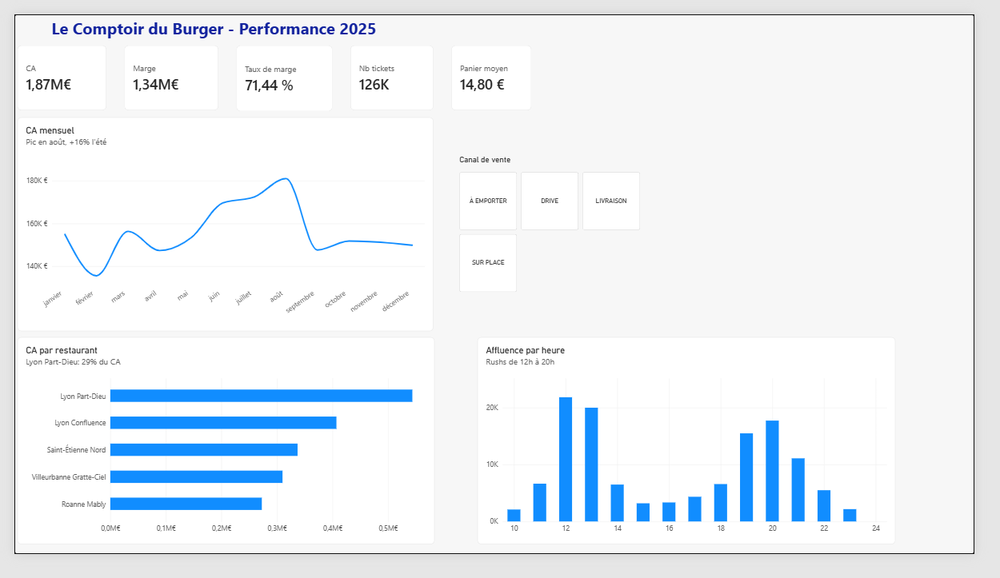

# 🍔 Le Comptoir du Burger – Tableau de bord des ventes 2025

Tableau de bord **Power BI** qui analyse l'activité d'une chaîne fictive de 5 restaurants de restauration rapide (Lyon, Villeurbanne, Saint-Étienne, Roanne).

## Problématique
Un responsable régional veut savoir :
- quels restaurants et quels canaux de vente rapportent le plus ;
- à quelles heures et à quelle période de l'année se concentre l'activité ;
- si le panier moyen dépend du canal (sur place, à emporter, drive, livraison).

## Données
- **3 tables** : Ventes (≈ 278 000 lignes), Produits (20), Restaurants (5)
- Données **fictives** générées pour l'exercice, sur l'année 2025

## Démarche
1. **Nettoyage (Power Query)** : suppression des lignes vides et de 120 doublons, harmonisation de la colonne Canal (casse et espaces), typage des colonnes.
2. **Modélisation** : schéma en étoile, avec la table de faits Ventes reliée aux dimensions Produits et Restaurants (relations 1 → plusieurs).
3. **Mesures DAX** : CA et coût avec `SUMX` + `RELATED` (le prix étant dans la table Produits), marge, taux de marge, nombre de tickets (`DISTINCTCOUNT`), panier moyen (`DIVIDE`). Colonne calculée `HOUR()` pour l'analyse par heure.
4. **Visualisation** : cartes KPI, courbe mensuelle, classement des restaurants, affluence par heure, segment par canal.

## Résultats clés
| Indicateur | Valeur |
|---|---|
| Chiffre d'affaires | 1,87 M€ |
| Marge brute | 1,34 M€ (71,4 %) |
| Tickets | 126 453 |
| Panier moyen | 14,80 € |

- **Deux rushs** (12-13 h et 19-20 h) concentrent près de 60 % des tickets : c'est là qu'il faut renforcer les équipes.
- **L'été (juin-août) génère 16 % de CA en plus** par mois que le reste de l'année, avec un pic en août.
- **Lyon Part-Dieu pèse 29 % du CA** de la chaîne, Roanne Mably 15 %.
- **Le panier moyen est stable d'un canal à l'autre** (≈ 14,70 à 14,90 €) : pour faire progresser le CA, il faut donc augmenter le nombre de clients plutôt que le panier.
- Les boissons ont le meilleur taux de marge (82 %), les burgers le plus faible (67 %) : proposer systématiquement une boisson améliore la rentabilité.

## Outils
Power BI Desktop · Power Query · DAX · Excel

## Fichiers
- `Dashboard_ComptoirDuBurger.pbix` : le rapport Power BI
- `Ventes_ComptoirDuBurger_2025.xlsx` : les données sources
- `dashboard.png` : capture du tableau de bord
